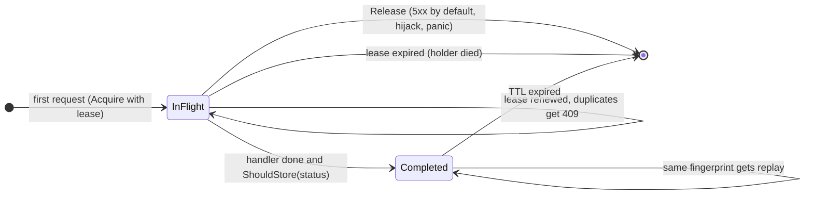

# go-idempotency

[](https://github.com/aozmekik/go-idempotency/actions/workflows/ci.yml)
[](LICENSE)

`net/http` middleware that makes retried POST and PATCH requests safe, implementing the IETF
[Idempotency-Key HTTP header field](https://datatracker.ietf.org/doc/draft-ietf-httpapi-idempotency-key-header/)
draft with in-memory, Redis and PostgreSQL stores.

> **Status: early, v0.1.0.** The API may change. Nothing is tagged or published to the Go module
> proxy yet. The middleware is tested (see [Testing](#testing)) but has no production users.

## Why

Networks fail after the server has done the work: the client times out, retries, and the customer is
charged twice. The usual fix is an idempotency key. The client sends a unique key with the request,
and the server runs the request once and answers every retry with the original response. Doing this
correctly takes more than a cache lookup:

- two copies of a request can arrive at the same time, on different instances;
- a client can reuse a key by mistake for a different request;
- the process handling the first copy can crash halfway;
- some responses (server errors, oversized bodies, cookies) should not be replayed as they are.

This library handles those cases behind one `http.Handler` wrapper, follows the IETF HTTPAPI working
group draft for status codes and header syntax, and documents where it deviates.

## Features

- **Draft semantics.** 400 for a missing or malformed key, 409 while the original is in flight,
  422 when a key is reused for a different request, and replay of the stored response with
  `Idempotent-Replayed: true`. All errors are [RFC 9457](https://www.rfc-editor.org/rfc/rfc9457)
  `application/problem+json`.
- **Strict key syntax.** The key is parsed as an [RFC 9651](https://www.rfc-editor.org/rfc/rfc9651)
  Structured Field String by a complete Item parser. It passes all 847 item test vectors of the HTTP
  WG [structured-field-tests](https://github.com/httpwg/structured-field-tests) suite.
- **Request fingerprinting.** SHA-256 over method, path, query, selected headers and the body hash,
  with an unambiguous length-prefixed encoding ([ADR 0001](docs/adr/0001-fingerprint-and-lock-semantics.md)).
- **Crash-safe locking.** Each in-flight claim carries a fencing token and a lease that is renewed
  while the handler runs, so a dead process blocks a key for at most one lease and a stale one
  cannot overwrite its successor.
- **Safe replay.** Headers are allowlisted. `Set-Cookie` is excluded unless you list it, hop-by-hop
  headers are rejected, and 5xx responses are not stored by default, so clients can retry them.
- **Per-caller scopes.** Keys from different accounts never interact.
- **Three stores** behind one interface, all checked by one exported conformance suite
  (`storetest`):
  - `memstore`: sharded map with TTL cleanup, in the core module;
  - `redisstore`: go-redis v9, one Lua script per operation;
  - `pgstore`: pgx v5, `INSERT ... ON CONFLICT`.
- **No dependencies in the core module.** The Redis and PostgreSQL stores are separate modules
  ([ADR 0002](docs/adr/0002-store-modules.md)).

## Install

Requires Go 1.26 or later.

```sh
go get github.com/aozmekik/go-idempotency            # middleware + memory store
go get github.com/aozmekik/go-idempotency/redisstore # Redis store
go get github.com/aozmekik/go-idempotency/pgstore    # PostgreSQL store
```

Not yet published to the Go module proxy. Once the repository is public, the first command works and
resolves a pseudo-version of `main`. The store modules can only be installed after the `v0.1.0`,
`redisstore/v0.1.0` and `pgstore/v0.1.0` tags are pushed, because each one requires a tagged core
version ([CONTRIBUTING.md](CONTRIBUTING.md#releasing)).

## Quick start

```go
package main

import (
	"log"
	"net/http"
	"time"

	idempotency "github.com/aozmekik/go-idempotency"
	"github.com/aozmekik/go-idempotency/memstore"
)

func main() {
	idem, err := idempotency.New(idempotency.Config{
		Store: memstore.New(),
		// Give every caller its own key space. Use the identity your
		// authentication middleware established, not a raw header.
		Scope: func(r *http.Request) string { return r.Header.Get("X-Account-ID") },
	})
	if err != nil {
		log.Fatal(err)
	}

	mux := http.NewServeMux()
	mux.Handle("POST /payments", idem.Handler(http.HandlerFunc(createPayment)))

	srv := &http.Server{Addr: ":8080", Handler: mux, ReadHeaderTimeout: 5 * time.Second}
	log.Fatal(srv.ListenAndServe())
}

func createPayment(w http.ResponseWriter, r *http.Request) {
	// Runs once per key, however often the client retries.
	w.Header().Set("Content-Type", "application/json")
	w.WriteHeader(http.StatusCreated)
	w.Write([]byte(`{"id":"pay_1"}`))
}
```

The key is a Structured Field String, so clients send it quoted:

```sh
curl -X POST localhost:8080/payments \
  -H 'Idempotency-Key: "8e03978e-40d5-43e8-bc93-6894a57f9324"' \
  -d '{"amount":1999,"currency":"EUR"}'
```

[`examples/payments`](examples/payments) is a runnable API with a captured curl walkthrough of every
case: replay, 422, 409, 400 and per-account scoping.

## How it works



`[*]` means "no record": the next request with the key runs the handler. A request whose
fingerprint differs from the stored one gets 422 in either state.

| Request | Result |
| --- | --- |
| Method not in `Config.Methods` (default POST, PATCH) | passed through untouched |
| No key, `KeyRequired` true (default) | `400` [`key-missing`](docs/problems.md#key-missing) |
| No key, `KeyRequired` false | passed through without protection |
| Key not a single quoted String, empty, or too long | `400` [`key-invalid`](docs/problems.md#key-invalid) |
| Body over `MaxBodyBytes` | `413` [`body-too-large`](docs/problems.md#body-too-large) |
| Store unreachable | `503` [`store-unavailable`](docs/problems.md#store-unavailable), handler not run |
| New key | handler runs; response stored if `ShouldStore(status)` |
| Same key, different fingerprint | `422` [`key-reused`](docs/problems.md#key-reused) |
| Same key and fingerprint, original running | `409` [`request-in-flight`](docs/problems.md#request-in-flight) |
| Same key and fingerprint, original completed | stored response with `Idempotent-Replayed: true` |

## API overview

```go
func New(cfg Config) (*Middleware, error)
func (m *Middleware) Handler(next http.Handler) http.Handler
func KeyFromContext(ctx context.Context) (string, bool) // the key, inside the handler
func ParseKey(fieldValue string) (string, error)        // server side
func FormatKey(key string) (string, error)              // client side: quote a key
```

| `Config` field | Default | Purpose |
| --- | --- | --- |
| `Store` | required | `memstore`, `redisstore`, `pgstore` or your own `Store` |
| `HeaderName` | `Idempotency-Key` | request header carrying the key |
| `Methods` | POST, PATCH | methods the middleware applies to |
| `KeyRequired` | always | per-request predicate; false lets keyless requests through |
| `Scope` | one global scope | namespace per caller, for example the account ID |
| `FingerprintHeaders` | none | request headers that are part of the fingerprint |
| `MaxKeyLength` | 255 bytes | longest accepted key |
| `MaxBodyBytes` | 1 MiB | request bodies are buffered to be hashed |
| `MaxResponseBytes` | 1 MiB | longest response captured for replay |
| `Lease` | 30 s | in-flight lock lifetime without renewal |
| `TTL` | 24 h | how long responses are replayable |
| `ShouldStore` | status < 500 | which responses are stored |
| `ReplayHeaders` | see [ADR 0003](docs/adr/0003-response-storage-policy.md) | response headers that are replayed |
| `ProblemTypeBase`, `ProblemWriter` | this repo's docs, RFC 9457 JSON | error format |
| `Logger` | `slog.Default()` | store failures and lost leases |

**Stores.** `memstore.New()` suits a single instance. Several instances need a shared store:

```go
store := redisstore.New(redisClient)             // any redis.UniversalClient
store := pgstore.New(pgxPool)                    // apply pgstore.Schema or call store.Migrate(ctx)
```

Expiry uses the Redis server's TTLs or PostgreSQL's `now()`, so application servers with skewed
clocks still agree. `pgstore` keeps expired rows invisible and removes them when you call
`DeleteExpired`. A custom store implements the four-method `Store` interface and passes
`storetest.Run`.

**Scope.** Without `Scope`, keys are global: a caller who learns another caller's key could send the
same request and receive that caller's stored response. The draft's security considerations
(Section 5) recommend combining the client's key with attributes known only to the server. Set
`Scope` to the authenticated identity whenever the API has more than one caller.

## Design notes and trade-offs

- [ADR 0001: fingerprint and lock semantics](docs/adr/0001-fingerprint-and-lock-semantics.md).
  The fingerprint covers method, path, query, opted-in headers and the body hash. Locks are leases
  with renewal and fencing tokens. Why authentication is a scope rather than part of the
  fingerprint, and why the result is at-most-once within a lease, not exactly-once.
- [ADR 0002: Redis and PostgreSQL stores as nested modules](docs/adr/0002-store-modules.md).
- [ADR 0003: what is stored, when, and what happens on failure](docs/adr/0003-response-storage-policy.md).
  Write-through capture; 5xx not stored by default, which deviates from the draft on purpose;
  panics count as 500; the store fails closed; oversized responses are never re-executed.
- [Problem types](docs/problems.md) documents every error response.

## Benchmarks

Measured on an Apple M1 Pro (8 cores), 16 GB RAM, macOS 26, `go1.27.2 darwin/arm64`, while other
heavy jobs shared the machine: the 1-minute load average was 9.5 to 10 during the middleware run
and about 7.5 during the store runs. Each figure is the median of 10 runs, with the range in
parentheses. Expect noise. The results are only meaningful relative to each other on this machine.

**Middleware overhead** (memory store, no network). Command:
`go test -run '^$' -bench . -benchmem -count=10 -benchtime=1s .`

| Benchmark | ns/op | B/op | allocs/op |
| --- | --- | --- | --- |
| `BareHandler` (handler alone, baseline) | 768 (694 to 1940) | 1856 | 16 |
| `FirstRequest/body=256` | 4297 (4130 to 5423) | 5326 | 51 |
| `FirstRequest/body=16384` | 12975 (12668 to 14157) | 22990 | 51 |
| `Replay` (handler not run) | 2275 (2129 to 2610) | 3384 | 30 |
| `ParseKey` (UUID key) | 161 (157 to 178) | 120 | 4 |

A request with a new key and a 256-byte body costs about 3.5 µs and 35 allocations more than the
bare handler here: parse the key, buffer and hash the body, claim the key, capture the response and
store it. The benchmarks call `ServeHTTP` directly with `httptest.ResponseRecorder`. They build
requests without `httptest.NewRequest` (whose 4 KiB parse buffer would dominate) and reset the store
every 10,000 requests, so heap growth does not depend on `-benchtime`. Parallel variants exist
(`BenchmarkFirstRequestParallel`, `BenchmarkBareHandlerParallel`), but on a machine this loaded
they did not scale and are not reported.

**Store round trips** against real local servers over loopback TCP on the same laptop. The figure
is one `Acquire` plus one `Complete`, the store work of a first request. Commands:
`IDEMPOTENCY_TEST_REDIS_ADDR=127.0.0.1:6391 go test -run '^$' -bench AcquireComplete -benchmem -count=10 -benchtime=1s .`
in `redisstore/`, and the same with `IDEMPOTENCY_TEST_PG_DSN=...` in `pgstore/`.

| Store | µs per Acquire + Complete |
| --- | --- |
| Redis 7.2.7 | 249 (238 to 336) |
| PostgreSQL 16.14 (`fsync=off` test instance) | 169 (137 to 191) |

These figures mostly measure loopback round-trip latency on a busy laptop. `redis-benchmark -t ping_mbulk -c 1`
reported p50 = 0.079 ms per round trip at the time. They are not a Redis-versus-PostgreSQL
comparison or a production estimate: the PostgreSQL instance ran with `fsync=off`, and both servers
shared CPUs with the benchmark and other jobs. There is deliberately no miniredis benchmark,
because an in-process emulator says nothing about Redis performance.

## Testing

```sh
go test -race ./...                                            # core module
(cd redisstore && go test -race ./...)                         # against miniredis
IDEMPOTENCY_TEST_REDIS_ADDR=localhost:6379 go test -race ./... # in redisstore/, real Redis
IDEMPOTENCY_TEST_PG_DSN=postgres://... go test -race ./...     # in pgstore/, real PostgreSQL
```

- `storetest.Run`: 17 conformance cases that every store passes. They cover lock-or-get, token
  fencing, lease renewal and expiry, TTL expiry, and 32 concurrent `Acquire` calls of which exactly
  one may win. Expiry cases use an injected clock (`memstore`, `pgstore`) or `miniredis.FastForward`.
- Middleware tests are table-driven. They include 64 concurrent duplicates over real HTTP connections
  that must run the handler exactly once. Lease renewal and expiry run on a virtual clock
  (`testing/synctest`) or an injected one; no test sleeps on wall time.
- Fuzz targets: `FuzzParseItem`, `FuzzParseKey` and `FuzzFormatKey`. CI fuzzes each for 60 s.
- RFC 9651 conformance: `SFV_TEST_VECTORS=<checkout of httpwg/structured-field-tests> go test -run TestVectors ./internal/sfv`.
  CI runs it at a pinned commit.

Statement coverage from `go test -cover` (Go 1.27.2, Apple M1 Pro). Real Redis 7.2.7 and PostgreSQL
16.14 servers were running locally for the store modules:

| Package | Coverage |
| --- | --- |
| `idempotency` | 98.4% |
| `internal/sfv` | 96.0% |
| `memstore` | 100.0% |
| `redisstore` | 96.4% |
| `pgstore` | 86.4% (uncovered: corrupt-row branches the table's CHECK constraints prevent) |

## Limitations and roadmap

Known limitations of v0.1.0:

- **The key must be quoted.** The draft defines the value as an sf-string, so the bare
  `Idempotency-Key: 8e03978e-...` that many existing clients send is rejected with 400.
- **At-most-once within a lease, not exactly-once.** If the store is unreachable for longer than a
  lease while a handler runs, another instance can run it again (ADR 0001).
- **Retries must be byte-identical.** The body is fingerprinted as bytes, not as parsed JSON.
- **Duplicates of an in-flight request get 409.** The server does not wait for the original.
- **The store fails closed.** If it is unreachable, requests get 503.
- The draft is an expired working-group Internet-Draft (draft-07, 15 October 2025); its semantics
  may still change.
- The Redis store uses one key per script, which is the requirement for Redis Cluster, but it has not
  been tested against a cluster. The PostgreSQL store has been tested on version 16 only. Its table
  name is fixed (`idempotency_keys`; use `search_path` to choose the schema).
- `memstore` has no entry limit beyond TTL expiry.
- Trailers are not captured.

Roadmap, in no particular order:

- opt-in lenient parsing for unquoted keys;
- a custom fingerprint function (for example canonical JSON);
- a transactional PostgreSQL integration that writes the idempotency record in the handler's own
  transaction, for exactly-once effects within one database;
- a fail-open option;
- an optional wait for in-flight originals instead of 409;
- metrics hooks;
- a configurable table name;
- an entry limit for `memstore`.

## Specifications and references

- J. Jena, S. Dalal,
  [The Idempotency-Key HTTP Header Field](https://datatracker.ietf.org/doc/html/draft-ietf-httpapi-idempotency-key-header-07),
  draft-ietf-httpapi-idempotency-key-header-07, IETF HTTPAPI WG, 15 October 2025 (expired).
- [RFC 9651](https://www.rfc-editor.org/rfc/rfc9651): Structured Field Values for HTTP. Its
  predecessor, RFC 8941, is the version the draft cites.
- [RFC 9457](https://www.rfc-editor.org/rfc/rfc9457): Problem Details for HTTP APIs.
- [RFC 9110](https://www.rfc-editor.org/rfc/rfc9110): HTTP Semantics (hop-by-hop fields,
  Section 7.6.1).
- [httpwg/structured-field-tests](https://github.com/httpwg/structured-field-tests), used as an
  external conformance suite. It is not vendored.
- Inspirations: Stripe's public documentation of idempotent requests, which is where the
  `Idempotent-Replayed` response header convention comes from; Martin Kleppmann's discussion of
  fencing tokens in *How to do distributed locking* (2016). No code was taken from other projects.

## Contributing

See [CONTRIBUTING.md](CONTRIBUTING.md) for the build, test and lint commands, and
[CHANGELOG.md](CHANGELOG.md) for release notes.

## License

[MIT](LICENSE)

Built by [Ahmed Semih Özmekik](https://github.com/aozmekik) at [Fergani](https://fergani.tr).
