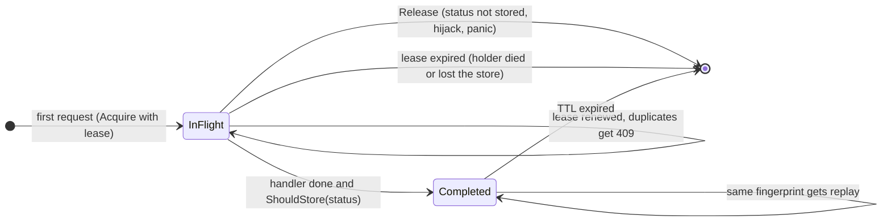

# go-idempotency

[](https://github.com/aozmekik/go-idempotency/actions/workflows/ci.yml)
[](LICENSE)

`net/http` middleware that makes retried POST and PATCH requests safe, implementing the IETF
[Idempotency-Key HTTP header field](https://datatracker.ietf.org/doc/draft-ietf-httpapi-idempotency-key-header/)
draft with in-memory, Redis and PostgreSQL stores.

> **Status: early, v0.1.0.** The API may change. Nothing is tagged or published to the Go module
> proxy yet. The middleware is tested (see [Testing](#testing)) but has no production users.

## Why

Networks fail after the server has done the work: the client times out, retries, and the customer is
charged twice. The usual fix is an idempotency key. The client sends a unique key with the request,
and the server runs the request once and answers every retry with the original response. Doing this
correctly takes more than a cache lookup:

- two copies of a request can arrive at the same time, on different instances;
- a client can reuse a key by mistake for a different request;
- the process handling the first copy can crash halfway;
- some responses (server errors, oversized bodies, cookies) should not be replayed as they are.

This library handles those cases behind one `http.Handler` wrapper, follows the IETF HTTPAPI working
group draft for status codes and header syntax, and documents where it deviates.

## Features

- **Draft semantics.** 400 for a missing or malformed key, 409 while the original is in flight,
  422 when a key is reused for a different request, and replay of the stored response with
  `Idempotent-Replayed: true`. All errors are [RFC 9457](https://www.rfc-editor.org/rfc/rfc9457)
  `application/problem+json`.
- **Strict key syntax.** The key is parsed as an [RFC 9651](https://www.rfc-editor.org/rfc/rfc9651)
  Structured Field String by a complete Item parser. It passes all 847 item test vectors of the HTTP
  WG [structured-field-tests](https://github.com/httpwg/structured-field-tests) suite.
- **Request fingerprinting.** SHA-256 over method, host, path, query, selected headers and the body
  hash, with an unambiguous length-prefixed encoding
  ([ADR 0001](docs/adr/0001-fingerprint-and-lock-semantics.md)) checked against an independent
  Python implementation.
- **Crash-safe locking.** Each in-flight claim carries a fencing token and a lease that is renewed
  while the handler runs. Failed renewals are retried against the lease deadline, so a store outage
  that ends shortly before the lease runs out does not lose it. A dead process blocks a key for at
  most one lease, a stale one cannot overwrite its successor, and every store call is bounded by the
  lease.
- **Safe replay.** Headers are allowlisted. `Set-Cookie` is excluded unless you list it, hop-by-hop
  headers are rejected, and by default server errors and "not now" or credential errors (401, 403,
  408, 409, 423, 425, 429) are not stored, so clients can retry them.
- **Per-caller scopes.** Keys from different accounts never interact.
- **Three stores** behind one interface, all checked by one exported conformance suite
  (`storetest`):
  - `memstore`: sharded map with TTL cleanup, in the core module;
  - `redisstore`: go-redis v9, one Lua script per operation;
  - `pgstore`: pgx v5, `INSERT ... ON CONFLICT`, with a `Migrate` that is safe to run from every
    instance at startup.
- **No dependencies in the core module.** The Redis and PostgreSQL stores are separate modules
  ([ADR 0002](docs/adr/0002-store-modules.md)).

## Install

Requires Go 1.26 or later.

```sh
go get github.com/aozmekik/go-idempotency            # middleware + memory store
go get github.com/aozmekik/go-idempotency/redisstore # Redis store
go get github.com/aozmekik/go-idempotency/pgstore    # PostgreSQL store
```

Not yet published to the Go module proxy. Once the repository is public, the first command works and
resolves a pseudo-version of `main`. The store modules can only be installed after the `v0.1.0`,
`redisstore/v0.1.0` and `pgstore/v0.1.0` tags are pushed, because each one requires a tagged core
version ([CONTRIBUTING.md](CONTRIBUTING.md#releasing)).

## Quick start

```go
package main

import (
	"log"
	"net/http"
	"time"

	idempotency "github.com/aozmekik/go-idempotency"
	"github.com/aozmekik/go-idempotency/memstore"
)

func main() {
	idem, err := idempotency.New(idempotency.Config{Store: memstore.New()})
	if err != nil {
		log.Fatal(err)
	}

	mux := http.NewServeMux()
	mux.Handle("POST /payments", idem.Handler(http.HandlerFunc(createPayment)))

	// With more than one caller, put authentication in front of the
	// middleware and set Config.Scope: see "Scope" below.
	srv := &http.Server{Addr: ":8080", Handler: mux, ReadHeaderTimeout: 5 * time.Second}
	log.Fatal(srv.ListenAndServe())
}

func createPayment(w http.ResponseWriter, r *http.Request) {
	// Runs once per key, however often the client retries.
	w.Header().Set("Content-Type", "application/json")
	w.WriteHeader(http.StatusCreated)
	_, _ = w.Write([]byte(`{"id":"pay_1"}`))
}
```

The key is a Structured Field String, so clients send it quoted:

```sh
curl -X POST localhost:8080/payments \
  -H 'Idempotency-Key: "8e03978e-40d5-43e8-bc93-6894a57f9324"' \
  -d '{"amount":1999,"currency":"EUR"}'
```

[`examples/payments`](examples/payments) is a runnable API with a curl walkthrough captured from a
real run: replay, 422, 409, the two kinds of 400, and the same key sent from another account.

## How it works



`[*]` means "no record": the next request with the key runs the handler. A request whose
fingerprint differs from the stored one gets 422 in either state.

| Request | Result |
| --- | --- |
| Method not in `Config.Methods` (default POST, PATCH) | passed through untouched |
| No key, `KeyRequired` true (default) | `400` [`key-missing`](docs/problems.md#key-missing) |
| No key, `KeyRequired` false | passed through without protection |
| Key not a single quoted String, empty, or too long | `400` [`key-invalid`](docs/problems.md#key-invalid) |
| Body over `MaxBodyBytes` | `413` [`body-too-large`](docs/problems.md#body-too-large) |
| Store unreachable | `503` [`store-unavailable`](docs/problems.md#store-unavailable) with `Retry-After: 1`, handler not run |
| New key | handler runs; response stored if `ShouldStore(status)` |
| Same key, different fingerprint | `422` [`key-reused`](docs/problems.md#key-reused) |
| Same key and fingerprint, original running | `409` [`request-in-flight`](docs/problems.md#request-in-flight) with `Retry-After: 1` |
| Same key and fingerprint, original completed | stored response with `Idempotent-Replayed: true` |

## API overview

```go
func New(cfg Config) (*Middleware, error)
func (m *Middleware) Handler(next http.Handler) http.Handler
func KeyFromContext(ctx context.Context) (string, bool) // the key, inside the handler
func ParseKey(fieldValue string) (string, error)        // server side
func FormatKey(key string) (string, error)              // client side: quote a key
```

| `Config` field | Default | Purpose |
| --- | --- | --- |
| `Store` | required | `memstore`, `redisstore`, `pgstore` or your own `Store` |
| `HeaderName` | `Idempotency-Key` | request header carrying the key |
| `Methods` | POST, PATCH | methods the middleware applies to |
| `KeyRequired` | always | per-request predicate; false lets keyless requests through |
| `Scope` | one global scope | namespace per caller, for example the account ID |
| `FingerprintHeaders` | none | request headers that are part of the fingerprint (the host always is) |
| `MaxKeyLength` | 255 bytes | longest accepted key |
| `MaxBodyBytes` | 1 MiB | request bodies are buffered to be hashed |
| `MaxResponseBytes` | 1 MiB | longest response captured for replay |
| `Lease` | 30 s | in-flight lock lifetime without renewal; renewed every `Lease/3` |
| `TTL` | 24 h | how long responses are replayable |
| `ShouldStore` | all but 5xx, 401, 403, 408, 409, 423, 425, 429 | which responses are stored ([ADR 0003](docs/adr/0003-response-storage-policy.md)) |
| `ReplayHeaders` | see [ADR 0003](docs/adr/0003-response-storage-policy.md) | response headers that are replayed |
| `ProblemTypeBase`, `ProblemWriter` | this repo's docs, RFC 9457 JSON | error format |
| `Logger` | `slog.Default()` | store failures and lost leases |

**Stores.** `memstore.New()` suits a single instance. Several instances need a shared store:

```go
redisStore := redisstore.New(redisClient) // any redis.UniversalClient
pgStore := pgstore.New(pgxPool)           // then pgStore.Migrate(ctx), or apply pgstore.Schema yourself
```

Expiry uses the Redis server's TTLs or PostgreSQL's `now()`, so application servers with skewed
clocks still agree. The Redis instance must use `maxmemory-policy noeviction`: every record has a
TTL, so the other policies can evict in-flight locks and stored responses. A Redis failover can
also lose recent records (see the [`redisstore` documentation](redisstore/redisstore.go)).
`pgstore.Migrate` takes an advisory lock, so every instance can call it at startup. `pgstore`
keeps expired rows invisible and removes them when you call `DeleteExpired`. A custom store
implements the four-method `Store` interface and passes `storetest.Run`.

**Scope.** Without `Scope`, keys are global: a caller who learns another caller's key could send the
same request and receive that caller's stored response. The draft's security considerations
(Section 5) recommend combining the client's key with attributes known only to the server. Set
`Scope` to the authenticated identity whenever the API has more than one caller, and read it from
the request context that your authentication middleware fills, never from a header the client
controls:

```go
idem, err := idempotency.New(idempotency.Config{
	Store: store,
	Scope: func(r *http.Request) string { return accountFrom(r.Context()) }, // set by authenticate
})
// ...
handler := authenticate(idem.Handler(api)) // authentication runs first
```

`ExampleConfig_scope` and [`examples/payments`](examples/payments) show this end to end. Put rate
limiting in front of the middleware too: rejections from either should not consume a key, although
the default policy does not store 401, 403 or 429 in any case.

## Design notes and trade-offs

- [ADR 0001: fingerprint and lock semantics](docs/adr/0001-fingerprint-and-lock-semantics.md).
  The fingerprint covers method, host, path, query, opted-in headers and the body hash. Locks are
  leases with deadline-aware renewal and fencing tokens, and every store call is bounded by the
  lease. Why authentication is a scope rather than part of the fingerprint, and why the result is
  at-most-once within a lease, not exactly-once.
- [ADR 0002: Redis and PostgreSQL stores as nested modules](docs/adr/0002-store-modules.md).
- [ADR 0003: what is stored, when, and what happens on failure](docs/adr/0003-response-storage-policy.md).
  Write-through capture; 5xx and transient or credential 4xx not stored by default, which deviates
  from the draft on purpose; panics count as 500; the store fails closed; oversized successes are
  never re-executed.
- [Problem types](docs/problems.md) documents every error response.

## Benchmarks

Measured on an Apple M1 Pro (8 cores), 16 GB RAM, macOS 26, `go1.27.2 darwin/arm64`, at commit
`14dde29`, in a fresh clone, while other heavy jobs shared the machine: the 1-minute load average
was 9.5 when the run started and when it ended. Command:
`go test -run '^$' -bench . -benchmem -count=10 -benchtime=1s .`

The benchmarks call `ServeHTTP` directly with `httptest.ResponseRecorder` and the memory store, so
they measure the middleware's CPU and allocation cost, not networking. allocs/op and B/op were the
same in all 10 runs (B/op to within 3 bytes) and are the reliable columns. ns/op is the median of
the 10 runs with the range in parentheses. On a machine this loaded it moves a lot between runs:
the same command, run a few minutes earlier on the previous commit (whose replay path is
identical), gave a `Replay` median of 2522 ns instead of 3493 ns. Treat it as an order of
magnitude.

| Benchmark | allocs/op | B/op | ns/op |
| --- | --- | --- | --- |
| `BareHandler` (handler alone, baseline) | 16 | 1856 | 724 (684 to 983) |
| `FirstRequest/body=256` | 56 | 5478 | 5549 (5121 to 6305) |
| `FirstRequest/body=16384` | 56 | 23142 | 15254 (13785 to 19120) |
| `Replay` (handler not run) | 34 | 3656 | 3493 (2954 to 4323) |
| `ParseKey` (UUID key) | 4 | 120 | 157 (154 to 160) |

A request with a new key and a 256-byte body costs 40 allocations and roughly 5 µs more than the
bare handler here: parse the key, buffer and hash the body, claim the key, capture the response and
store it. The requests are built without `httptest.NewRequest` (whose 4 KiB parse buffer would
dominate), and the store is reset every 10,000 requests, so heap growth does not depend on
`-benchtime`. The context deadline that bounds each store call accounts for 8 of those allocations
(545 bytes) on a first request and 4 (272 bytes) on a replay: removing the two
`context.WithTimeout` calls in a scratch copy of this commit and running
`go test -run '^$' -bench 'FirstRequest/body=256|Replay' -benchmem -count=1 -benchtime=20000x .`
gave 48 and 30 allocations. Parallel variants exist (`BenchmarkFirstRequestParallel`,
`BenchmarkBareHandlerParallel`), but on a machine this loaded their timings say little, so they
are not reported.

Store latency is not reported. On a shared laptop, `BenchmarkAcquireComplete` in `redisstore/` and
`pgstore/` would mostly measure loopback round trips and scheduling, not the stores, and there is
deliberately no miniredis benchmark, because an in-process emulator says nothing about Redis
performance. Run them against your own servers: `IDEMPOTENCY_TEST_REDIS_ADDR=... go test -run '^$'
-bench . -benchmem` in `redisstore/`, and the same with `IDEMPOTENCY_TEST_PG_DSN=...` in `pgstore/`.

## Testing

```sh
go test -race ./...                                            # core module
(cd redisstore && go test -race ./...)                         # against miniredis
IDEMPOTENCY_TEST_REDIS_ADDR=localhost:6379 go test -race ./... # in redisstore/, real Redis
IDEMPOTENCY_TEST_PG_DSN=postgres://... go test -race ./...     # in pgstore/, real PostgreSQL
```

- `storetest.Run`: 17 conformance cases that every store passes. They cover lock-or-get, token
  fencing, lease renewal and expiry, TTL expiry, byte-exact header values (obs-text, control bytes,
  NUL), and 32 concurrent `Acquire` calls of which exactly one may win. Expiry cases use an injected
  clock (`memstore`, `pgstore`) or `miniredis.FastForward`.
- Middleware tests are table-driven. They include 64 concurrent duplicates over real HTTP connections
  that must run the handler exactly once. Lease renewal and expiry run on a virtual clock
  (`testing/synctest`) or an injected one, including store outages that hang or fail renewals until
  shortly before the deadline; no test sleeps on wall time.
- `pgstore` tests also run 10 rounds of 8 concurrent `Migrate` calls on a fresh schema and force
  `Acquire`'s insert-then-select race with a wrapped connection.
- Fuzz targets: `FuzzParseItem`, `FuzzParseKey` and `FuzzFormatKey`. CI fuzzes each for 60 s.
- RFC 9651 conformance: `SFV_TEST_VECTORS=<checkout of httpwg/structured-field-tests> go test -run TestVectors ./internal/sfv`.
  CI runs it at a pinned commit.

Statement coverage from `go test -count=1 -cover ./...` in each module (Go 1.27.2, Apple M1 Pro),
with local Redis 7.2.7 and PostgreSQL 16.14 servers for the store modules
(`IDEMPOTENCY_TEST_REDIS_ADDR`, `IDEMPOTENCY_TEST_PG_DSN`):

| Package | Coverage |
| --- | --- |
| `idempotency` | 98.9% to 99.4% (see below) |
| `internal/sfv` | 96.0% |
| `memstore` | 100.0% |
| `redisstore` | 97.3% |
| `pgstore` | 96.4% |

The core figure varies between runs because one branch only runs when a renewal timer fires just
as the handler finishes. The remaining uncovered statements in the core and the stores are
defensive: `json.Marshal` errors that cannot occur for the types involved, a reply shape the Lua
script never returns, and corrupt rows that the PostgreSQL table's CHECK constraints prevent.

## Limitations and roadmap

Known limitations of v0.1.0:

- **The key must be quoted.** The draft defines the value as an sf-string, so the bare
  `Idempotency-Key: 8e03978e-...` that many existing clients send is rejected with 400.
- **At-most-once within a lease, not exactly-once.** If the store stays unreachable for almost a
  whole lease while a handler runs, or the process stalls that long, another instance can run it
  again (ADR 0001). The Redis store also needs `maxmemory-policy noeviction`, and a Redis failover
  can lose recent locks and responses.
- **Retries must be byte-identical.** The body is fingerprinted as bytes, not as parsed JSON.
- **The host is compared as sent.** Case does not matter, but `example.com` and `example.com:443`
  are different requests. The scheme is not part of the fingerprint, because behind a
  TLS-terminating proxy the middleware cannot see it.
- **Duplicates of an in-flight request get 409.** The server does not wait for the original.
- **The store fails closed.** If it is unreachable, requests get 503.
- **The first response waits for the store write.** It is delivered after `Complete` returns: one
  round trip normally, and up to the remaining lease if the store stalls.
- The draft is an expired working-group Internet-Draft (draft-07, 15 October 2025); its semantics
  may still change.
- The Redis store uses one key per script, which is the requirement for Redis Cluster, but it has not
  been tested against a cluster. The PostgreSQL store has been tested on version 16 only. Its table
  name is fixed (`idempotency_keys`; use `search_path` to choose the schema).
- `memstore` has no entry limit beyond TTL expiry.
- Trailers are not captured.

Roadmap, in no particular order:

- opt-in lenient parsing for unquoted keys;
- a custom fingerprint function (for example canonical JSON);
- a transactional PostgreSQL integration that writes the idempotency record in the handler's own
  transaction, for exactly-once effects within one database;
- a fail-open option;
- an optional wait for in-flight originals instead of 409;
- an optional `WAIT` for Redis replicas after each write, which narrows (but does not close) the
  failover window;
- metrics hooks;
- a configurable table name;
- an entry limit for `memstore`.

## Specifications and references

- J. Jena, S. Dalal,
  [The Idempotency-Key HTTP Header Field](https://datatracker.ietf.org/doc/html/draft-ietf-httpapi-idempotency-key-header-07),
  draft-ietf-httpapi-idempotency-key-header-07, IETF HTTPAPI WG, 15 October 2025 (expired).
- [RFC 9651](https://www.rfc-editor.org/rfc/rfc9651): Structured Field Values for HTTP. Its
  predecessor, RFC 8941, is the version the draft cites.
- [RFC 9457](https://www.rfc-editor.org/rfc/rfc9457): Problem Details for HTTP APIs.
- [RFC 9110](https://www.rfc-editor.org/rfc/rfc9110): HTTP Semantics (hop-by-hop fields,
  Section 7.6.1).
- [httpwg/structured-field-tests](https://github.com/httpwg/structured-field-tests), used as an
  external conformance suite. It is not vendored.
- Inspirations: Stripe's public documentation of idempotent requests, which is where the
  `Idempotent-Replayed` response header convention comes from; Martin Kleppmann's discussion of
  fencing tokens in *How to do distributed locking* (2016), whose caveats about Redis-based locks
  (timing assumptions, and locks lost when a replica takes over) are why `redisstore` documents
  its deployment requirements. No code was taken from other projects.

## Contributing

See [CONTRIBUTING.md](CONTRIBUTING.md) for the build, test and lint commands, and
[CHANGELOG.md](CHANGELOG.md) for release notes.

## License

[MIT](LICENSE)

Built by [Ahmed Semih Özmekik](https://github.com/aozmekik) at [Fergani](https://fergani.tr).
